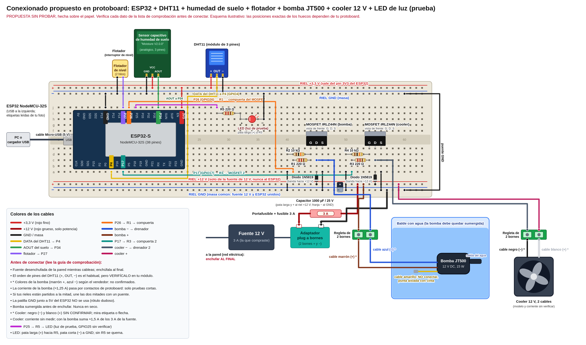

# Conexionado: ESP32 + sensores + bomba + cooler (protoboard)

Estado (2026-11-16): el sensor de suelo **no está conectado** (con P34 al aire las lecturas de suelo son ruido, no mediciones) y la etapa del cooler está **desconectada** del montaje. **La bomba fue probada en hardware el 2026-11-16** (confirmación del usuario) con un ESP32 nuevo, el MOSFET etiquetado IRLZ44Z (el que venía del cooler) y R2 de 10 kΩ colocada: gira solo al pulsar `p` por el monitor serie (`src/pump.cpp`, GPIO26) y no arranca sola al enchufar. El cooler se probó el 2026-11-12 (tecla `f`, GPIO17) con la etapa anterior, hoy desmontada. El flotador **no está probado**; para el flotador no hay firmware. Dibujos de las pruebas de la bomba: [mínimo](img/conexionado%20protoboard%20bomba.png) y [con R2](img/conexionado%20protoboard%20bomba%20R2.png). **Incidente:** un primer ESP32 dejó de responder (ni admitía la subida ni emitía por serie); el usuario cree que pudo tocar un cable de 12 V, sin confirmar. Un cable rojo suelto del adaptador plug a bornes falseó varias pruebas, así que conclusiones como "un MOSFET está defectuoso" **no son fiables**. No se midió corriente ni calentamiento, y la polaridad del cooler no se leyó en su etiqueta (funciona con negro − y blanco +). El resto de este documento conserva el diseño y las comprobaciones originales. Diseño para la PCB casera: [pcb/esquematico-pcb.pdf](pcb/esquematico-pcb.pdf) y borrador del trazado [pcb/layout-pcb-borrador.pdf](pcb/layout-pcb-borrador.pdf). Imagen: [img/conexionado-protoboard.png](img/conexionado-protoboard.png) (fuente editable: [.svg](img/conexionado-protoboard.svg)).

## Resultado de la revisión (skill `electronics-review`)

**No se puede confirmar que funcione.** La conectividad del esquema es coherente (se comprobó por script que las redes GND, 3V3, +12 V, P4, P34, P27, P26, P17, las dos compuertas y los dos drenadores son distintas y quedan unidas como se pretende, y que ningún pin usado es de flash, de arranque ni de USB-serie). Eso no sustituye una medición ni una prueba física. Faltan estos datos:

| Dato pendiente | Por qué importa |
|---|---|
| Orden de pines del módulo DHT11 | El dibujo usa `+`, `OUT`, `−` (habitual); si el tuyo es otro, hay que mover los cables |
| Rango de alimentación y de AOUT del sensor de suelo | Se alimenta con 3,3 V según lo propuesto, sin verificar |
| Colores de la bomba (marrón +, azul −) | Dato del vendedor; la etiqueta no indica polaridad |
| Función del cable amarillo | Desconocida; no se conecta |
| IRLZ44Z con 3,3 V en la compuerta (el MOSFET en uso, etiqueta leída por el usuario el 2026-11-16) | Hoja de datos IRLZ44Z/S/LPbF leída (2026-11-16): pines 1 G, 2 D, 3 S; VGS(th) 1,0–3,0 V; RDS(on) máx. 13,5 mΩ (10 V), 20 mΩ (5 V), 22,5 mΩ (4,5 V); sin valor garantizado a 3,3 V; la curva típica (Fig. 3, leída a ojo) da ≈10 A hacia 3,2 V. Con el cooler (2026-11-12) y con la bomba (2026-11-16) funciona en el montaje (observación del usuario). Antes se documentó como IRLZ44N (VGS(th) 1,0–2,0 V; ≈20 A a 3 V típicos): el usuario indicó después que la etiqueta dice IRLZ44Z |
| Corriente real de la bomba | Estimada en 15 W ÷ 12 V ≈ 1,25 A, sin medir |
| Corriente del cooler | No se sabe (cooler genérico de 12 V). Si es un ventilador de PC típico suele ser una fracción de amperio, pero es un dato general, no medido: leer la etiqueta o medir |
| Polaridad del cooler | Montado con negro (−) y blanco (+) y funciona (observación del usuario); no se leyó en etiqueta ni carcasa |
| Si los rieles de tu protoboard son continuos | Algunas los traen cortados a la mitad |
| Orientación de la placa en la protoboard | Se supone que la foto del serigrafiado es de la cara inferior; ver nota |

### Riesgos detectados

1. **Corriente de la bomba por la protoboard.** Unos 1,25 A (más el arranque) pasan por contactos de protoboard y cables finos; el valor típico que se cita para estos contactos es de alrededor de 1 A (dato general, no medido). Para este montaje: **solo pruebas cortas**, toca el MOSFET y los cables para notar calentamiento. Para uso continuo, pasar la etapa de potencia a placa perforada o bornes. El cooler comparte el riel de +12 V: si consume unos 0,25 A (supuesto), el total ronda 1,5 A, aún por debajo del fusible de 3 A, pero hay que medirlo.
1a. **Rieles divididos en segmentos.** En la protoboard del usuario las bandas de + y − están partidas en segmentos: un hueco del riel puede no estar conectado con el otro extremo. Por eso el LED de la luz (GPIO25) no encendió hasta cambiar el retorno a GND de segmento (observación del usuario, 2026-11-20). Comprobar la continuidad de cada riel, o unir los segmentos con un puente, antes de dar por buena una conexión; afecta también a los rieles de +3,3 V, +12 V y GND.
1b. **Polaridad del cooler.** Funciona con negro (−) y blanco (+), pero no se leyó en su etiqueta; si cambias de cooler, confírmala antes de conectarlo.
2. **Polaridad.** Un error de polaridad puede dañar la bomba (si tiene electrónica interna) y el capacitor electrolítico. El diodo en inverso quemaría el fusible.
3. **Sin protección contra marcha en seco todavía.** Requiere firmware que lea el flotador y bloquee el riego. Hasta entonces, la bomba solo se prueba a mano y sumergida.
4. **Agua y electricidad.** Bornes, fuente y protoboard secos y por encima del balde.
5. **Placa ancha.** La disposición necesita una protoboard completa (unas 63 columnas, 830 puntos). La NodeMCU-32S deja solo 1 hueco libre por pin; por eso cada señal sale con un cable puente.

## Conexiones (tabla)

Pines del ESP32 leídos del serigrafiado de la foto (ver [hardware-inventory.md](hardware-inventory.md)). Con el USB a la izquierda, la fila de arriba de la protoboard son las etiquetas de la columna derecha de tu foto, de derecha a izquierda (5V … 3V3), y la fila de abajo son las de la columna izquierda de la foto de abajo a arriba (CLK … GND).

| # | Desde | Hasta | Notas |
|---|---|---|---|
| 1 | Pin **3V3** del ESP32 | Riel superior `+` (3,3 V) | Alimenta DHT11 y sensor de suelo |
| 2 | Pin **GND** del ESP32 (el de la fila superior, junto a P13/P12) | Riel superior `−` (GND) | |
| 3 | Sensor suelo **GND** | Riel superior `−` | |
| 4 | Sensor suelo **VCC** | Riel superior `+` (3,3 V) | |
| 5 | Sensor suelo **AOUT** | Pin **P34** (GPIO34) | ADC1, solo entrada |
| 6 | DHT11 **+** | Riel superior `+` (3,3 V) | Verifica el orden de tu módulo |
| 7 | DHT11 **OUT** (DATA) | Pin **P4** (GPIO4) | La fila inferior; P4 queda junto a P0: separa los cables |
| 8 | DHT11 **−** | Riel superior `−` | |
| 9 | Flotador, hilo 1 | Pin **P27** (GPIO27) | Entrada con pull-up interno |
| 10 | Flotador, hilo 2 | Riel superior `−` | |
| 11 | Pin **P26** (GPIO26) | Resistencia R1 220 Ω → compuerta (G) del MOSFET | |
| 12 | Compuerta (G) | R2 10 kΩ → riel inferior GND | Mantiene la bomba apagada al arrancar |
| 13 | **Source (S)** del MOSFET | Riel inferior GND | |
| 14 | **Drenador (D)** del MOSFET | Cable azul de la bomba (vía regleta) y ánodo del diodo | |
| 15 | Cátodo del diodo 1N5819 (banda) | Riel inferior +12 V | |
| 16 | Capacitor 1000 µF / 25 V | `+` al riel +12 V, `−` al riel GND | Pata larga = + |
| 17 | Fuente 12 V + (borne `+` del adaptador) | Fusible 3 A → riel inferior +12 V | |
| 18 | Fuente 12 V − (borne `−` del adaptador) | Riel inferior GND | |
| 19 | Cable marrón de la bomba (+) | Riel inferior +12 V (vía regleta) | Color según el vendedor |
| 20 | Riel inferior GND | Riel superior GND (puente en un extremo) | **Masa común** entre fuente y ESP32 |
| 21 | Pin **P17** (GPIO17) del ESP32 | Resistencia R3 220 Ω → compuerta (G) del MOSFET 2 | Fila inferior. Pin libre, sin función de arranque ni de flash |
| 22 | Compuerta (G) del MOSFET 2 | R4 10 kΩ → riel inferior GND | Mantiene el cooler apagado al arrancar |
| 23 | **Source (S)** del MOSFET 2 | Riel inferior GND | |
| 24 | **Drenador (D)** del MOSFET 2 | Cable negro del cooler (vía regleta 2) y ánodo del diodo 2 | Color según el usuario; polaridad sin confirmar |
| 25 | Cátodo del diodo 2 1N5819 (banda) | Riel inferior +12 V | |
| 26 | Cable blanco del cooler (+) | Riel inferior +12 V (vía regleta 2) | Polaridad sin confirmar |
| 27 | Pin **P25** (GPIO25) del ESP32 | Resistencia R5 220 Ω → ánodo (pata larga, +) del LED | LED de prueba de la luz (`src/light.cpp`). Pin sin verificar en hardware |
| 28 | Cátodo (pata corta, −) del LED | Riel superior `−` (GND) | Sin R5 el LED se quema. Es solo una luz indicadora: la lámpara real y su etapa de potencia no están elegidas |
| — | Cable amarillo de la bomba | **No se conecta**, punta aislada | |

El ESP32 se alimenta por su USB; los 12 V solo van a la bomba y al cooler. **Nunca** conectes 12 V a un pin ni al 3V3 del ESP32.

## Lista de comprobación antes de enchufar

1. Fuente de 12 V desenchufada de la pared mientras cableas.
2. Cada pin del ESP32 coincide con la etiqueta de su placa (no con la posición del dibujo).
3. Con multímetro y sin energía: continuidad entre los GND (fuente −, riel GND, GND del ESP32) y **sin** continuidad entre +12 V y GND, ni entre 3V3 y GND.
4. Diodo con la banda hacia +12 V; capacitor con la franja (−) hacia GND.
5. MOSFET visto de frente (cara con texto): G, D, S de izquierda a derecha (confirmado en las hojas de datos de Infineon del IRLZ44NPbF y del IRLZ44ZPbF).
6. La bomba sumergida antes de enchufar.
7. Primera prueba: solo la bomba con la fuente (como ya hiciste), luego con el MOSFET comandado a mano con un cable a 3,3 V en la compuerta, y solo al final con el ESP32.
8. Cooler: confirmar la polaridad (flecha o signos en la carcasa, o etiqueta) antes de conectarlo; repetir con el MOSFET 2 el mismo diodo (banda a +12 V), la misma comprobación de continuidad y la misma secuencia de pruebas que con la bomba.
9. Ambas etapas de potencia usan el mismo riel de +12 V: probar primero una carga y luego la otra, tocando MOSFET y cables para notar calentamiento.

## Orientación de la placa (supuesto a verificar)

La foto del serigrafiado parece ser de la **cara inferior** (no se ve el módulo ni los botones). Por eso el dibujo coloca el 3V3 en la fila de arriba, en el extremo opuesto al USB. Si al montar la placa los nombres no coinciden con lo que muestra el dibujo, tu foto era de la cara superior: avísame y lo corrijo antes de conectar nada.
